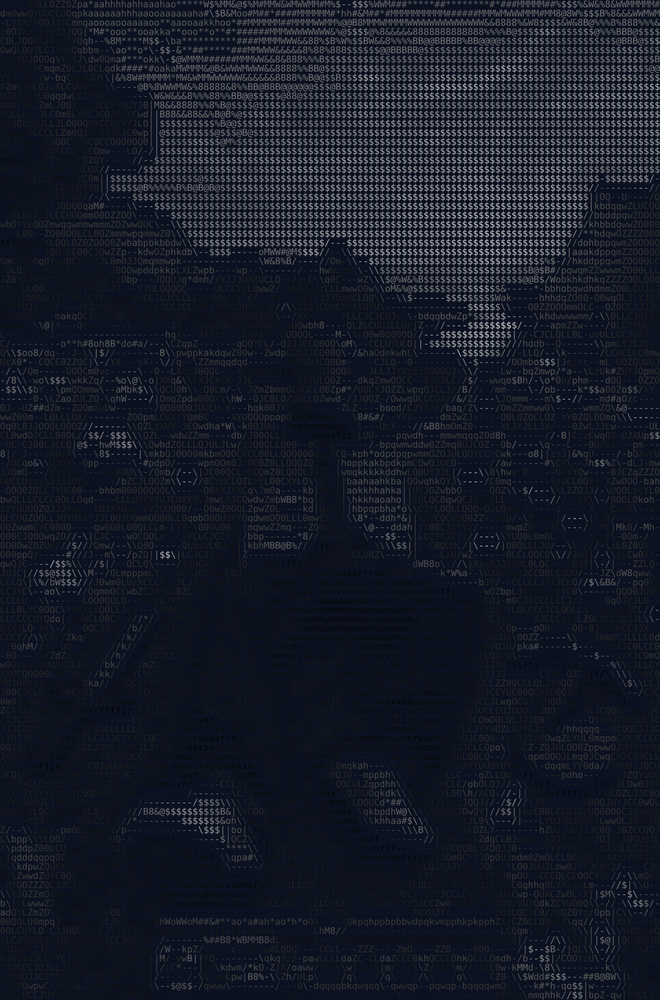

[maybelinuxo.kdns.fr](https://itsfizys.gg) &nbsp;·&nbsp;
[discord](https://discord.gg/aerox) &nbsp;·&nbsp;
[youtube](https://youtube.com/@aeroxdevs) &nbsp;·&nbsp;
[instagram](https://www.instagram.com/aeroxdevs)

> Student developer. Founder of [AeroX](https://discord.gg/aerox), a dev community 
> built around the process of turning ideas into real things.

I build Discord bots and the tooling around them. Most of what I ship lives inside 
[AeroX Development](https://github.com/AeroXDevs), 7k+ members, from concept to commit. 

<samp>javascript &nbsp; typescript &nbsp; discord.js &nbsp; node &nbsp; python &nbsp; docker &nbsp; git &nbsp; linux</samp>

• Kabir Shaikh - A genius ***Architecture***; he plans and I write, just like a writer and a poet.

[ Discord ] [ Instagram ]

**[AeroX-CV2-Music-Bot](https://github.com/itsfizys/AeroX-CV2-Music-Bot)** &nbsp;·&nbsp; <samp>javascript, discord.js</samp> 
Music bot built on Discord's Components V2. The flagship bot of AeroX, 
22 stars, 33 forks, and actively maintained.

**[piccdn](https://github.com/itsfizys/piccdn)** &nbsp;·&nbsp; <samp>typescript, rawgithubapi</samp> 
A clean, api containing images of multiple categories to use in your project  
in minutes, no boilerplate fighting required.

**[animequotescdn](https://github.com/itsfizys/animequotescdn)** &nbsp;·&nbsp; <samp>javascript, html</samp> 
A web api to generate anime quote cards containing over 8000 quotes, 
clean architecture, ready to scale.

**[minecraft-dev-guide](https://github.com/itsfizys/minecraft-dev-guide)** &nbsp;·&nbsp; <samp>java, glsl</samp> 
Everything Minecraft development in one place: Paper plugins, Forge and 
Fabric mods, shaders, OpenGL/GLSL, and the full plugin ecosystem.

credit to itfizy so I could use it (;
